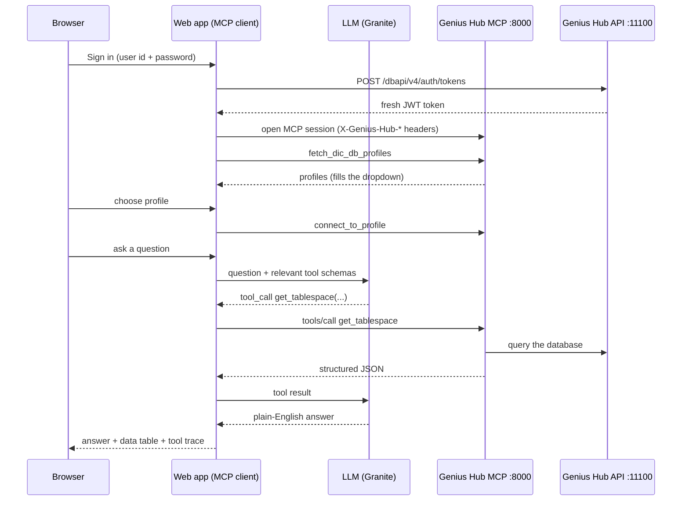

# Db2 Genius Chat

Ask questions about your Db2 environment in plain English. The app is a small
**MCP client**: it lets an LLM call the tools published by the **Db2 Genius Hub MCP
server**, so every answer is built from live data rather than from the model's memory.

> "Which tablespaces are almost full?" &rarr; the LLM picks `get_tablespace` &rarr; the MCP
> server queries Db2 &rarr; the LLM summarises the result, and the raw rows are shown beside it.

This is a **demo / reference implementation**. A built-in **How it works** guide
(button in the top bar and on the sign-in page) explains MCP, the request flow, how to
connect, and lists the live tool catalogue &ndash; it is meant for client walkthroughs.

## 1. How MCP works (the 60-second version)

| Piece | Role | In this demo |
|---|---|---|
| **MCP client** | The AI-facing application that discovers and calls tools | This web app (`server.js`) |
| **MCP server** | Publishes tools (name, description, input schema) and runs them | Db2 Genius Hub MCP server, port `8000` |
| **Tools** | Functions such as `get_tablespace`, `analyze_lock_waits` | 39 published, 33 offered to the LLM |
| **LLM** | Decides *which* tool to call and writes the final answer | IBM Granite on Ollama |

The LLM never touches Db2. It only replies "call tool X with arguments Y"; the app
executes that call through MCP and hands the result back.



## 2. Connecting to the MCP server

Every MCP session needs the Genius Hub location and a token, sent as HTTP headers:

| Header | Meaning |
|---|---|
| `X-Genius-Hub-Hostname` | Genius Hub host name |
| `X-Genius-Hub-Port` | Genius Hub API port (default `11100`) |
| `X-Genius-Hub-Protocol` | `http` or `https` |
| `X-Genius-Hub-Token` | JWT from `POST /dbapi/v4/auth/tokens` |

```bash
# 1. get a token
curl -X POST 'http://db2server:11100/dbapi/v4/auth/tokens' \
  -H 'Content-Type: application/json' \
  -d '{"userid":"<user>","password":"<password>"}'
```

**This app does step 1 on every sign-in**, so a new token is used for every session and
nothing long-lived is stored. The token expires after about 8 hours; signing in again gets a new one.

To use the *same* MCP server from IBM Bob or another client, add to `.bob/mcp.json`:

```json
{
  "mcpServers": {
    "db2-genius-mcp": {
      "type": "streamable-http",
      "url": "https://<genius-hub-host>:8000/mcp",
      "headers": {
        "X-Genius-Hub-Hostname": "<genius-hub-host>",
        "X-Genius-Hub-Port": "11100",
        "X-Genius-Hub-Protocol": "http",
        "X-Genius-Hub-Token": "${env:GENIUS_HUB_TOKEN}"
      },
      "disabled": false
    }
  }
}
```

### Use it from Python

[`examples/call_tool.py`](examples/call_tool.py) opens an MCP session, selects a profile and calls one tool
(`get_tablespace`). It needs only `pip install httpx`, no MCP SDK, so it also shows what is on the wire.

```bash
# log in with a user and password (a fresh token is requested)
GH_USER=<user> GH_PASSWORD=<password> python3 examples/call_tool.py

# ...or reuse a token you already have
GH_TOKEN=<token> python3 examples/call_tool.py
```

Optional variables: `GH_HOST` (default `db2server`), `GH_PORT` (`11100`), `GH_PROTOCOL` (`http`),
`MCP_URL` (`https://<GH_HOST>:8000/mcp`), `PROFILE` (`db2server-sample`).

The three calls that matter:

```python
mcp.initialize()                                                        # open the session
mcp.call_tool("connect_to_profile", {"profile_name": "db2server-sample"})
mcp.call_tool("get_tablespace", {"params": {}})                         # most tools wrap arguments in "params"
```

`connect_to_profile` takes `profile_name` directly; most other tools take their arguments inside `params`.
The script sets `verify=False` because the MCP server ships with a self-signed certificate; remove it once you
install a CA-signed one.

## 3. Run the app

Requirements: **Node.js 22+**, network access to Genius Hub (`:11100`, `:8000`) and to an
OpenAI-compatible LLM endpoint.

```bash
cd db2-genius-chat
npm install
cp .env.example .env      # then edit the values
npm start                 # http://127.0.0.1:3000
```

Sign in with a Genius Hub account, pick a profile from the dropdown, then click an example
or type your own question.

### Configuration (`.env`)

| Variable | Default | Purpose |
|---|---|---|
| `GH_HOST` / `GH_PORT` / `GH_PROTOCOL` | `db2server` / `11100` / `http` | Genius Hub API |
| `MCP_URL` | `https://db2server:8000/mcp` | Genius Hub MCP endpoint |
| `INSECURE_TLS` | `true` | Accept the MCP server's self-signed certificate. Set `false` with a CA-signed one |
| `LLM_BASE_URL` | OpenAI | Any OpenAI-compatible endpoint (Ollama, vLLM, OpenAI, watsonx proxy&hellip;) |
| `LLM_API_KEY` | – | API key (`ollama` for Ollama) |
| `LLM_MODEL` | `gpt-4o` | Model name (`granite-optimized` in the demo) |
| `LLM_TIMEOUT_MS` | `240000` | Per-LLM-call timeout; raise for slow CPU hosts |
| `HOST` / `PORT` | `127.0.0.1` / `3000` | Where this app listens |

## 4. What the user sees

- **Sign-in** &ndash; Genius Hub user id and password; token fetched per session.
- **Profile dropdown** &ndash; filled from `fetch_dic_db_profiles`; choosing one calls `connect_to_profile`.
- **Examples panel** &ndash; 24 clickable questions grouped by topic; the first group asks about *all* databases.
- **Tool chips** &ndash; show which MCP tools ran and how long they took; click one to see the arguments the model chose.
- **Data table** &ndash; the raw rows the answer was built from, so the answer can be verified.
- **How it works** &ndash; tabs: What is MCP, Request flow, Connect, My session (masked token, expiry, MCP session id), Tools (live catalogue), Troubleshooting.

## 4a. Enterprise questions (all databases at once)

MCP tools act on **one database at a time** (`connect_to_profile`, then a tool). To answer
*"which databases have…?"* the app loops over every Genius Hub profile and compares the results.
Choose **All databases** in the dropdown, or ask any question containing phrases such as
*all databases*, *which databases*, *every database*, *across the estate* &ndash; it is detected
automatically, even in single-database mode.

| Ask | Tools called per database | Flagged when |
|---|---|---|
| "Show all the databases with space issues" | `get_tablespace` | any tablespace &ge; 80% warning, &ge; 95% critical |
| "Show me the databases that have not backed up this week" | `fetch_db_history` | newest successful backup older than the window (7 days for "this week", `3 days`, `today`, `2 weeks`&hellip; are understood) = warning; older than 30 days or none = critical |
| "Show me all the databases with resource issues" | `get_cpu_summary`, `get_memory_summary`, `get_bufferpool_statistics`, `analyze_lock_waits` | CPU avg &ge; 70%, memory avg &ge; 85%, buffer pool hit ratio < 90% (pools with &ge; 1000 logical reads), any lock wait |
| "Which databases are unhealthy?" | `perform_database_health_check` | real findings (checks that merely *could not run* are reported but not counted as unhealthy) |
| "Give me an overview of all my databases" | all of the above | any of the above |

Results appear as a table sorted worst-first, with severity colours, a summary in plain English,
a tool-call trace, and a "How these were judged" panel.

**Why this part does not use the LLM.** Comparing databases against thresholds is arithmetic: code is
exact, repeatable and cannot invent a number. The LLM is used for open-ended questions about one
database. All rules live in [`fleet.js`](fleet.js) (`THRESHOLDS`), so they are easy to tune to a
client's standards. The logic is covered by the pure functions `evalSpace`, `evalBackup`,
`evalResources` and `evalHealth`, which are easy to unit-test.

**Behaviours worth knowing**
- A profile that cannot be reached is listed as **Critical** with the error; it does not stop the run.
- "No data" (tool returned nothing usable) is shown but never counted as a problem.
- An empty Db2 backup history is reported as *"No backup recorded in Db2 history"*. Backups made by tools
  that do not write to the Db2 history file will look like this.
- The check is sequential: about 1&ndash;9 MCP calls per database, roughly 1&ndash;3 s each. Five demo databases took 5&ndash;11 s.
  Hundreds of databases would need parallel connections (one MCP session per database) and a progress UI.
- Running the checks switches the MCP connection between profiles; the previously selected single database
  is reconnected afterwards.

## 5. Design notes

**Small models need help.** The Genius Hub tools have very large JSON schemas (about 70 KB for all 39 tools; the
largest, `fetch_tables`, is about 8 KB) and many optional arguments. A small CPU-hosted model (Granite) handles them poorly if
sent raw, so `server.js` does the following. A larger model (GPT-4o, Claude, Granite on GPU) needs
none of it and could be given all tools directly:

| Technique | Where | Why |
|---|---|---|
| Offer only 4-6 tools matching the question (`TOOL_ROUTES`) | `pickTools` | Fewer tools &rarr; far better tool choice |
| Compact schemas, hide `cols_*` / `member` options | `compactSchema` | Fits the context window and speeds up CPU inference |
| Flatten the `{params: {...}}` wrapper and re-wrap on call | `mcpToolsToOpenAI`, `runTool` | Models fill flat schemas more reliably |
| Coerce `"None"`, `"False"`, `"5"` to real types | `coerceArg` | Small models emit strings for everything |
| Drop filter values the user never typed | `dropInventedFilters` | Prevents invented table/tablespace names |
| Trim tool results and force a "summarise only this data" step | `compactResult` | Stops fabricated rows and SQL |
| Apply "more than / less than N%" in code on tablespace results | `applyPercentFilter` | Small models ignore numeric thresholds |
| Reconnect and retry once on "session not found" | `attachResilientMcp` | The MCP server can drop a session; the app opens a new one with the stored token, re-selects the profile and retries |
| Fixed message when a tool fails for good | `runTool` | Stops the model improvising ("let me try a different approach") without live data |

**Security.**
- Passwords go only to Genius Hub and are never stored; the Genius Hub token stays server-side; the browser holds an opaque `HttpOnly` cookie.
- Sessions are closed with the MCP `logout` tool on sign-out and after 30 idle minutes.
- `authenticate`, `connect_to_profile`, `logout` and `get_session_info` are hidden from the LLM; the app owns session handling.
- `execute_safe_sql` is read-only (enforced by the MCP server).
- Model output is rendered through `marked` + `DOMPurify`; a strict CSP is set.
- TLS verification is disabled **only** for the MCP connection (via a scoped `undici` Agent, not a process-wide override).

**Not production-ready as shipped:** sessions are in memory (restart = sign in again), there is one
Node process, no HTTPS termination, no rate limiting and no audit log. Put it behind a reverse proxy
with TLS before exposing it beyond localhost.

## 6. Troubleshooting

| Symptom | Likely cause / fix |
|---|---|
| "Invalid Genius Hub user id or password" | Token request rejected &ndash; check credentials in the Genius Hub console |
| "Could not reach the Genius Hub MCP server" | MCP server not running, port 8000 blocked, or wrong `MCP_URL` |
| "Session expired" | Idle timeout, app restart, or expired token &ndash; sign in again |
| "I can't answer this from live data" | A tool call failed and could not be recovered; the real reason is shown. A dropped MCP session is reconnected automatically (count under *My session*) |
| Empty profile dropdown | No profiles for this user in Genius Hub; add one, press the reload button |
| Very slow answers | CPU-hosted LLM (20&ndash;90 s is normal); Db2 calls themselves take about a second |
| "The operation was aborted due to timeout" | LLM took longer than `LLM_TIMEOUT_MS`; raise it or check the Ollama host is not busy |
| Model answers without calling a tool | Rephrase with "Show me&hellip;" / "List&hellip;" or use an example; consider a larger model |

## 7. Project layout

```
db2-genius-chat/
  server.js        Express app: login/token, MCP client, LLM tool loop, SSE streaming, /api/*
  fleet.js         Enterprise checks across all profiles: intent, thresholds, evaluators
  public/
    index.html     sign-in, app shell, "How it works" dialog
    app.js         UI logic (profiles, examples, chat, guide)
    style.css
  examples/
    call_tool.py   standalone Python example: one MCP tool call, no SDK
  .env.example     configuration template
```
